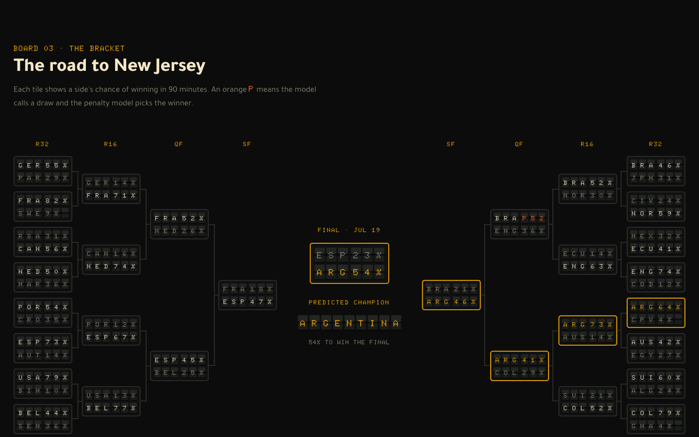
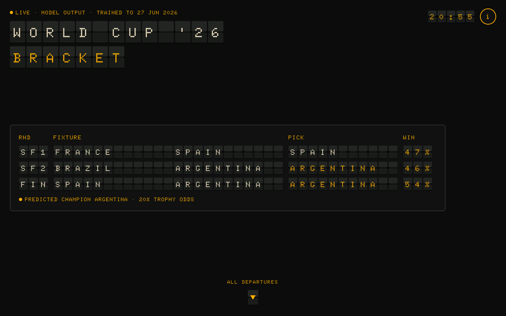
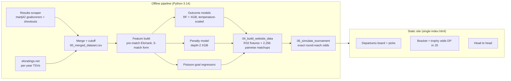

# WC26 Prediction

**Live site:** https://caelwynder.github.io/WC26-prediction/



I scraped 26 years of international football results and Elo ratings, built leakage-free form features, and trained models to predict every knockout match of the **2026 FIFA World Cup**. Then I built a site that shows the predictions as an airport departures board. You land on the semi-finals and final, scroll through every Round-of-32 fixture, follow the full bracket to New Jersey, and see each team's odds of lifting the trophy.

Everything is frozen at **27 June 2026**, the end of the group stage. No match after that date touches training, features or inference, so every knockout prediction is a genuine forecast, not hindsight.

## What I ran

| | |
|---|---|
| Models | **XGBoost** outcome model (H/D/A) + Random Forest, a **penalty shootout** model, and Poisson goal regressors |
| Data | 23,955 internationals, 2000-01-04 → 2026-06-27, 38 features; split 48.1% home / 23.5% draw / 28.4% away |
| Evaluation | Time-based holdout: all 5,260 matches from 2021-06-01 onward, never shuffled |
| Accuracy / log loss | **60.0%** / **0.8707** (XGBoost + temperature scaling, T = 1.141) |
| Baselines | Always home win 48.1%; Elo sign alone **60.5%**; Random Forest 60.1% |
| Bracket odds | Exact dynamic program over the bracket, cross-checked against 10k Monte Carlo runs |

Knockout football has no draws, so the outcome and shootout models work together:
`P(A advances) = P(A wins) + P(draw) × P(A wins shootout)`.

Current champion odds (`website/data.json`, generated 2026-07-13):

| Argentina | Spain | France | Colombia | England | Brazil |
|---|---|---|---|---|---|
| **20.0%** | **16.1%** | **14.3%** | **12.5%** | **10.5%** | **6.2%** |

## What you can do on the site



- **Read the landing board:** the predicted semi-finals and final, with the champion and their trophy odds.
- **Browse Departures:** all 31 knockout matches, with each pick and its win probability.
- **Make your own picks:** tap a team to make them the winner. Every later round re-predicts from there, and your picks are saved in your browser. *Clear my picks* resets the board.
- **Follow the bracket:** each tile shows a side's chance of winning in 90 minutes. An orange **P** means the model calls a draw and the penalty model picks the winner.
- **Check the trophy odds:** every possible path through the bracket, weighted by the models, not only the line shown. Your picks change these odds live.
- **Pick two teams:** a head-to-head between any two of the 48 teams on neutral ground.
- **Open the info panel** (ⓘ) for how the picks are made.

## Architecture



There's no backend and no API keys. All inference happens offline; the site reads one `data.json` and re-runs the same bracket dynamic program in JavaScript whenever you change a pick. It deploys to GitHub Pages on every push to `website/`.

## Reproduce

```bash
git clone https://github.com/caelwynder/WC26-prediction.git
cd WC26-prediction/project-root
python3.14 -m venv .venv && source .venv/bin/activate
pip install -r requirements.txt

python scripts/run_full_pipeline.py      # scrape → merge → features → outcome + penalty models
python scripts/02_team_fvector.py        # feature vectors for upcoming fixtures
python scripts/03_predict_matches.py     # per-fixture predictions
python scripts/04_build_website_data.py  # website/data.json
python scripts/06_simulate_tournament.py # exact bracket odds
cd .. && node serve.mjs                  # http://localhost:3000/website/
```

Checks: `python -m pytest tests/ -q` from `project-root/`. Ten tests guard merge orientation, leakage, the cutoff date, train/inference parity and bracket structure.

> **macOS without Homebrew:** the PyPI XGBoost wheel looks for `libomp.dylib` under `/opt/homebrew`. Either `brew install libomp` or export `DYLD_LIBRARY_PATH=.venv/lib/python3.14/site-packages/sklearn/.dylibs`. `run_full_pipeline.py` does this for you.

## Pipeline

| Stage | Script | Output |
|---|---|---|
| 1 | `00_run_preprocessing_pipeline.py` | Scrapes results, Elo, goalscorers and shootouts; merges; applies the cutoff |
| 2 | `01_build_model_dataset.py` | Pre-match Elo/rank, tournament weights, rolling 5-match form → `01_model_dataset.csv` |
| 3 | `02_team_fvector.py` | Same features, computed on demand for unplayed fixtures |
| 4 | `02_train_outcome_model.py` | RF + XGB on a time split, plus the temperature calibrator |
| 5 | `03_predict_matches.py` | Scores upcoming fixtures with both models |
| 6 | `04_build_website_data.py` | R32 fixtures + pairwise table → `website/data.json` |
| 7 | `05_train_penalty_model.py` | Shootout model from internationals since 2000 |
| 8 | `06_simulate_tournament.py` | Round-reach and champion odds |

`scripts/features.py` is the single source of the feature schema. Every stage imports it, so training and inference can't drift apart.

## Read this before drawing conclusions

- **The model ties an Elo-only baseline.** 60.0% against 60.5% for backing the higher-Elo side. The form features help calibration but not yet accuracy.
- **Draw recall is 7.3%, and that's correct.** Draws are 23.5% of matches but almost never the single most likely outcome. High draw recall on this data usually means a leak.
- **It once reported 87.9%. That was a leak.** Pre-match rank was computed as `rank − rank_change`, but eloratings' `rank_change` is zero on 93.4% of home losses, so it smuggled the result in. Honest accuracy is ~60%, and [`tests/test_no_leakage.py`](project-root/tests/test_no_leakage.py) now fails if it comes back.
- **Shootouts are near coin flips.** The penalty model is deliberately tiny and only matches the base rate; expect probabilities in 0.38–0.65, never confident calls.
- Goals use independent Poisson regressors, which slightly misprice low-scoring games. About 1,833 rows fail the results/Elo merge and are dropped.
- For scale, the best test accuracy in the 2017 Soccer Prediction Challenge was about 50.5% ([survey](https://arxiv.org/abs/2403.07669)), but that scored club leagues. National teams are easier because Elo gaps are wider, so it's context, not a leaderboard.

## Credits

- **Results, goalscorers, shootouts:** [martj42/international_results](https://github.com/martj42/international_results)
- **Elo ratings and world rank:** [eloratings.net](https://www.eloratings.net/)
- **World Cup shootout kicks:** [jfjelstul/worldcup](https://github.com/jfjelstul/worldcup)
- **Libraries:** XGBoost, scikit-learn, pandas, NumPy, SciPy

No license file yet, so all rights are reserved by default.
